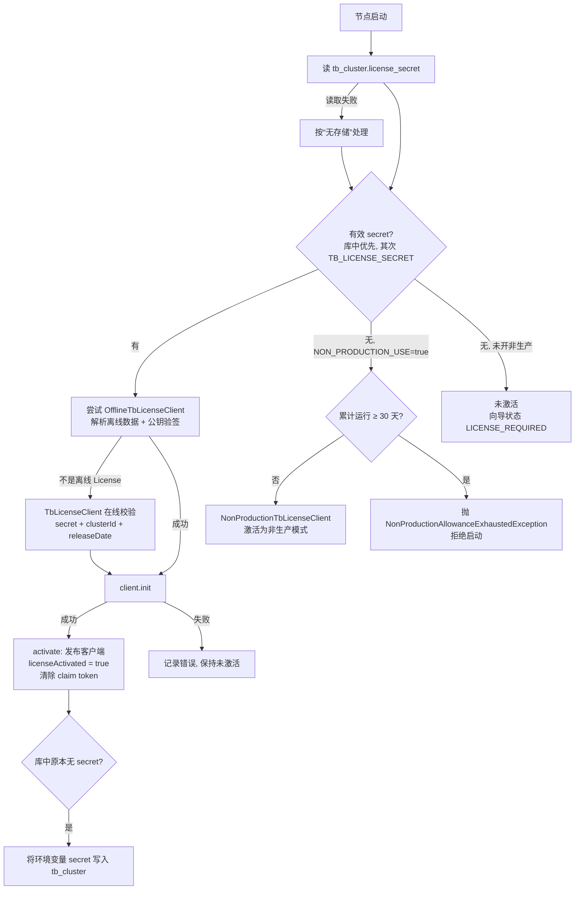
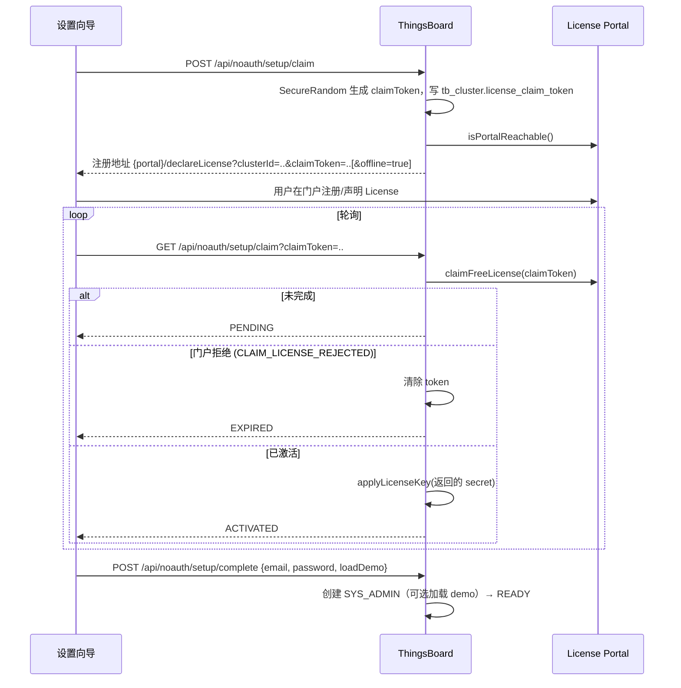

# ThingsBoard License 授权与验证机制

> 适用版本：`4.4.1-SNAPSHOT`（本仓库）。
> 本文梳理仓库内所有涉及 License 授权的代码文件，以及授权、验证、限额执行的完整流程。
> 外部闭源依赖 `org.thingsboard.license:client:3.0.0` 只列出其公开 API（类与方法签名），不涉及其内部实现。

---

## 1. 总体架构

```
┌──────────────────────────── 前端 ui-ngx ────────────────────────────┐
│ 设置向导(激活) · License 管理页 · 开发模式水印 · 限额/功能弹窗        │
└───────────────┬─────────────────────────────────────────────────────┘
                │ REST: /api/noauth/setup/*  /api/admin/license/*  /api/admin/subscriptionInfo …
┌───────────────▼──────────── application 模块 ──────────────────────┐
│ SystemSetupFilter (未就绪→HTTP 423)   NonProductionHeaderFilter       │
│ SystemSetupController / AdminController / SystemInfoController       │
│ DefaultSystemSetupService (状态机 + 领取流程)                          │
│ NonProduction*Service · LicenseUpdateBroadcaster · 统计上报 · 升级预检  │
└───────────────┬─────────────────────────────────────────────────────┘
┌───────────────▼──────────── dao 模块 (dao.subscription) ───────────┐
│ BasicLicenseActivationService (激活/锁定/重试/集群收敛)               │
│ BasicSubscriptionService (额度、功能开关、开发模式判定)               │
│ TbClusterStore (tb_cluster 表)   LicenseCapacityStartupGate           │
│ NonProductionEntitlementEnforcer (30 天上限→停机)                     │
└───────────────┬─────────────────────────────────────────────────────┘
┌───────────────▼──── 闭源 org.thingsboard.license:client:3.0.0 ─────┐
│ TbLicenseClient (在线) · OfflineTbLicenseClient (离线签名)            │
│ NonProductionTbLicenseClient (无 key) · TbLicenseCtx · 统计接口        │
└───────────────┬─────────────────────────────────────────────────────┘
                ▼
     https://license.alsun.io  (License Portal / 授权服务器)
```

持久化位置：

| 存储 | 内容 |
|---|---|
| PostgreSQL `tb_cluster` 表（单行） | `cluster_id`、`license_secret`、`license_claim_token`、`non_production_uptime_ms`、`non_production_last_tick`、`non_production_confirmed_ts` |
| PostgreSQL `tb_instance_registry` 表 | 集群内各服务实例（`service_id`、`last_activity_ts`），供 License 客户端做实例登记 |
| 文件 `instance-license.data`（默认为进程工作目录，`TB_LICENSE_INSTANCE_DATA_FILE` 可改） | Base64 编码的 JSON：`licenseSecret`、`clusterId`、`instanceId`、`planData`、`subscriptionData`、`aiToken`、`ts`、`releaseDate`、`encodedPart`、`signature`、`retryAttempt`。**含凭证，不应提交到版本库或外发** |

---

## 2. 代码文件清单

### 2.1 后端核心：`dao/src/main/java/org/thingsboard/server/dao/subscription/`

| 文件 | 职责 |
|---|---|
| `LicenseActivationService.java` | 激活服务接口：激活状态、License 版本、应用/预览/清除 key、集群收敛、非生产模式 |
| `BasicLicenseActivationService.java` | **激活核心实现**（`@Profile("!install & !test")`）：启动激活、选择客户端（离线/在线/非生产）、`applyLicenseKey`、`clearLicense`、`lock`、每 5 分钟 `retryActivation`、`reconcileLicenseState` 集群收敛、实例数据文件维护 |
| `SubscriptionService.java` | 订阅/授权检查接口：额度、功能、白标、Edge、Trendz、开发模式、AI Token |
| `BasicSubscriptionService.java` | **执行实现**：`createDeviceAllowed` / `createAssetAllowed` / `createEdgeAllowed` / `createAgentAllowed`、`whiteLabeling*`、`edgeEnabled`、`trendzEnabled`、`isFeatureEnabled` / `checkFeatureAllowed`、`isDevelopment`、`getLicenseInfo` / `getSubscriptionInfo` / `refreshLicense`、`getAiToken` |
| `InstallSubscriptionService.java` | `install` / `test` profile 下的替代实现（安装程序不做授权检查） |
| `TbClusterStore.java` | `tb_cluster` 读写：License secret、claim token、非生产累计运行时长（`NON_PRODUCTION_UPTIME_LIMIT_MS` = 30 天，`TICK_INTERVAL_MINUTES` = 5） |
| `PlatformFeature.java` | 受授权控制的功能枚举：`INTEGRATIONS`、`SCHEDULER`、`REPORTING` |
| `SubscriptionInfoMapper.java` | 将 `planData` 解读为 `SubscriptionInfo`；统一“无限额”判定规则 |
| `CommunityGrantPlan.java` | 免费授权（Community Grant）套餐识别键 `COMMUNITY_GRANT_KEY` |
| `LicenseCapacity.java` | 设备/资产数是否超出授权上限的判定与提示文案（启动、升级、换 key 共用） |
| `LicenseCapacityStartupGate.java` | 启动完成时（`ApplicationReadyEvent`）检查：免费授权下设备/资产超限则抛 `EntityCapExceededException` 拒绝启动 |
| `EntityCapExceededException.java` | 上述超限异常 |
| `LicenseKeyRejections.java` | 将授权服务器错误码映射为管理员可读的拒绝原因 |
| `LicensePortal.java` | 门户地址常量 `https://license.alsun.io` |
| `LicenseReleaseDate.java` | 由 `Version.PROJECT_BUILD_DATE` 解析版本发布日期，传给客户端做版本覆盖校验 |
| `LicenseStateChangedEvent.java` | 本节点 License 变更事件（触发集群广播） |
| `LicenseStateReconciliationListener.java` | 集群收敛后通知 application 模块重置本地向导状态 |
| `NonProductionEntitlementEnforcer.java` | 每 15 分钟检查非生产累计运行时长，满 30 天锁定并 `System.exit(1)` |
| `NonProductionAllowanceExhaustedException.java` | 非生产额度用尽异常（启动时抛出即拒绝启动） |

### 2.2 后端：`application` 模块

**过滤器 / 安全配置**

| 文件 | 职责 |
|---|---|
| `config/SystemSetupFilter.java` | 对 `/api/**`、Trendz API 拦截：状态非 `READY` 时返回 `SETUP_INCOMPLETE`（HTTP 423 LOCKED） |
| `config/ThingsboardSecurityConfiguration.java` | 定义 `SETUP_PROTECTED_ENTRY_POINTS` 与 `SETUP_ALLOWED_ENTRY_POINTS`（白名单：设置向导、设备 API、登录、2FA、License key/预览、非生产确认等） |
| `config/NonProductionHeaderFilter.java` | 开发模式下所有响应加 `X-ThingsBoard-Non-Production: true` |

**控制器**

| 文件 | 相关接口 |
|---|---|
| `controller/SystemSetupController.java` | `GET /api/noauth/setup/state`、`GET/POST /api/noauth/setup/claim`、`POST /api/noauth/setup/license`、`POST /api/noauth/setup/complete`、`POST /api/admin/license/key`、`POST /api/admin/license/preview`、`POST /api/admin/nonProduction/confirm` |
| `controller/AdminController.java` | `GET /api/admin/licenseUsageInfo`、`GET /api/admin/subscriptionInfo`、`POST /api/admin/refreshLicense` |
| `controller/SystemInfoController.java` | 向前端暴露 `isDevelopment`、`edgeEnabled`、`trendzEnabled`、各 `PlatformFeature` 开关、`communityGrantLicense` |
| `controller/BaseController.java` | `checkFeatureAllowed` 等通用授权检查辅助 |
| `controller/IntegrationController.java`、`ConverterController.java` | `PlatformFeature.INTEGRATIONS` 检查 |
| `controller/ReportController.java`、`ReportTemplateController.java`、`DashboardReportController.java` | `PlatformFeature.REPORTING` 检查；报表开发模式标记 |
| `controller/SchedulerEventController.java` | `PlatformFeature.SCHEDULER` / `REPORTING` 检查 |
| `controller/WhiteLabelingController.java` | `whiteLabelingAllowed` / `whiteLabelingEnabled` |
| `controller/NotificationController.java` | 白标相关判断 |

**异常处理**

| 文件 | 职责 |
|---|---|
| `exception/SystemSetupIncompleteException.java` | 未完成设置异常，携带当前 `SystemSetupState` |
| `exception/ThingsboardSetupIncompleteResponse.java` | 423 响应体（含 setupState） |
| `exception/ThingsboardErrorResponseHandler.java` | `SETUP_INCOMPLETE`→423；`SubscriptionException`→带 `SubscriptionEntry` 的错误响应 |
| `exception/ThingsboardErrorResponse.java` | 错误响应携带 `SubscriptionEntry` |

**设置向导 / 门户**

| 文件 | 职责 |
|---|---|
| `service/setup/SystemSetupService.java` | 接口 |
| `service/setup/DefaultSystemSetupService.java` | **状态机**（`getState`）、自动领取（`requestClaim` / `pollClaim` / `claim`）、手动 key、创建初始 sysadmin（`completeSetup`）、`applyLicenseKeyAndReport` |
| `service/setup/LicensePortalClient.java`、`DefaultLicensePortalClient.java` | 封装客户端静态调用：`claimFreeLicense`、`isPortalReachable`、`previewSubscription`；门户地址可由系统属性 `tb.license.server` 覆盖 |

**License 运行支持：`service/license/`**

| 文件 | 职责 |
|---|---|
| `DefaultTbLicenseCtx.java` | 实现客户端所需的 `TbLicenseCtx`：提供 `clusterId`（缺失时自愈创建 `tb_cluster`）、`serviceId`、实例登记读写 |
| `DefaultTbLicenseStatisticsService.java` | 实现 `TbLicenseStatisticsService`：汇总实体数量、规则节点类型、集成/转换器/报表数量、数据库大小等，随在线校验请求上报（`license.stats.enabled`，默认开启） |
| `InstanceRegistryCleanUpService.java` | 集群服务列表变化时清理 `tb_instance_registry` |
| `LicenseUpdateBroadcaster.java` | 监听 `LicenseStateChangedEvent`，经队列向所有节点广播 `SystemUpdateMsg(LICENSE)` |
| `NonProductionUptimeService.java` | 非生产模式每 5 分钟累加运行时长（停机时间不计） |
| `NonProductionConfirmationService.java` | Development 套餐 key 的 30 天周期性“非生产使用”确认（记审计日志，时间戳存 `tb_cluster`） |

**其他执行点**

| 文件 | 作用 |
|---|---|
| `service/queue/SystemUpdateMsgHandler.java` | 收到 `LICENSE` 广播后异步执行 `reconcileLicenseState` |
| `service/install/LicenseCapacityUpgradePreflight.java` | 升级前预检：免费授权下设备/资产超限则拒绝升级（由 `install/ThingsboardInstallService.java` 调用） |
| `service/install/TbClusterSchema.java` | `tb_cluster` 的 DDL 与查询语句 |
| `service/install/SqlDatabaseUpgradeService.java`、`service/install/lts/V4_3_1_6Migration.java` | 升级时建表/迁移 `tb_cluster` |
| `service/ai/OnPremiseTbAiTokenProvider.java` | AI 功能使用 License 下发的 `aiToken` |
| `service/agent/AgentAutoInstallService.java` | 依据 License 版本判断 Agent 支持 |
| `service/edge/EdgeContextComponent.java`、`service/edge/rpc/session/EdgeGrpcSession.java` | Edge 连接时检查 `edgeEnabled` |
| `service/solutions/DefaultSolutionService.java` | 解决方案模板安装时检查功能与 Edge 额度 |
| `service/iot_hub/DefaultDevicePackageService.java`、`DefaultIotHubService.java` | IoT Hub 包安装时检查 `INTEGRATIONS` |
| `service/sync/ie/DefaultEntitiesExportImportService.java`、`service/sync/solution/DefaultSolutionExportImportService.java` | 导入实体时检查对应功能 |
| `service/report/ReportJobProcessor.java`、`report/dashboard/DefaultDashboardReportService.java`、`report/LocalTbReportCtxProvider.java` | 报表打开发模式水印 |

### 2.3 公共模块

| 文件 | 职责 |
|---|---|
| `common/data/.../setup/SystemSetupState.java` | `LICENSE_REQUIRED` / `ACCOUNT_REQUIRED` / `NON_PRODUCTION_CONFIRMATION_REQUIRED` / `READY` |
| `common/data/.../setup/SetupInfo.java`、`LicenseClaimStatus.java`、`LicenseChangeResult.java` | 设置向导与领取流程的 DTO（领取状态：`NOT_REQUESTED`、`PENDING`、`ACTIVATED`、`EXPIRED`） |
| `common/data/.../subscription/SubscriptionException.java`、`SubscriptionEntry.java`、`SubscriptionInfo.java` | 授权异常、受限项、订阅信息 |
| `common/data/.../LicenseInfo.java`、`LicenseUsageInfo.java` | License 用量信息 |
| `common/data/.../DataConstants.java` | `NON_PRODUCTION_NOTICE = "Development Mode — non-production use only"` |
| `common/proto/src/main/proto/queue.proto` | `SystemUpdateMsg` 类型 `LICENSE = 1`（广播不携带 secret） |
| `common/report/.../util/NonProductionPdfNotice.java`、`NonProductionImageNotice.java`、`service/PdfReportService.java`、`service/CsvReportService.java`、`context/RemoteTbReportCtxProvider.java` | PDF/图片/CSV 报表中的非生产标记 |

### 2.4 DAO 实例登记

| 文件 | 职责 |
|---|---|
| `dao/.../instance/registry/InstanceRegistryService.java`、`BaseInstanceRegistryService.java`、`InstanceRegistryDao.java` | 实例登记服务 |
| `dao/.../sql/instance/registry/JpaInstanceRegistryDao.java`、`dao/.../model/sql/InstanceRegistryEntity.java`、`ModelConstants.java` | JPA 实现与实体 |
| `dao/.../service/validator/DeviceDataValidator.java`、`AssetDataValidator.java`、`EdgeDataValidator.java`、`AgentDataValidator.java` | 新建实体时调用 `create*Allowed` 检查额度 |

### 2.5 SQL / 配置 / 构建 / 打包

| 文件 | 内容 |
|---|---|
| `dao/src/main/resources/sql/schema-entities.sql` | `tb_cluster`（含单行唯一索引 `tb_cluster_single_row`）、`tb_instance_registry` |
| `application/src/main/data/upgrade/lts/4.3.1.6/schema_update.sql`、`lts/4.4.0.0/schema_update.sql`、`pe/schema_update.sql` | 升级时新增/变更 `tb_cluster` 列 |
| `application/src/main/resources/thingsboard.yml` → `license:` | `secret`(`TB_LICENSE_SECRET`)、`non_production_use`(`NON_PRODUCTION_USE`)、`instance_data_file`(`TB_LICENSE_INSTANCE_DATA_FILE`)、`stats.enabled`(`TB_ANONYMOUS_USAGE_REPORTING`) |
| `dao/pom.xml` | 依赖 `org.thingsboard.license:client:3.0.0` |
| `packaging/java/scripts/install/upgrade.sh`、`packaging/java/scripts/windows/upgrade.bat` | 提示在配置中设置 `TB_LICENSE_SECRET`，以便升级前做容量预检 |
| `LICENSE` | BUSL-1.1 许可证条款（Additional Use Grant 约束免费生产使用） |

### 2.6 前端 `ui-ngx/src/app/`

| 文件 | 职责 |
|---|---|
| `core/http/system-setup.service.ts`、`shared/models/system-setup.models.ts` | 设置状态、领取、提交 key、完成设置 |
| `core/guards/setup.guard.ts`、`modules/setup/setup-routing.module.ts`、`modules/setup/pages/setup/activate-platform.component.{ts,html}` | 首次设置向导（激活平台页） |
| `modules/home/pages/admin/license-management.component.{ts,html}`、`license-hand-off-dialog.component.ts`、`admin-routing.module.ts`、`admin.module.ts`、`core/services/menu.models.ts` | 系统管理员的 License 管理页（查看/更换 key） |
| `core/http/admin.service.ts`、`core/http/entity.service.ts`、`shared/models/settings.models.ts` | 获取 `subscriptionInfo` / `licenseUsageInfo` |
| `core/http/development.service.ts`、`app.component.ts` | 开发模式检测与全局水印 |
| `shared/import-export/import-export.service.ts`、`modules/home/components/dashboard-page/dashboard-image-dialog.component.ts` | 导出 CSV/HTML/图片加非生产标记 |
| `core/auth/auth.models.ts`、`core/auth/auth.reducer.ts` | 登录态中的 `licenseVersion`、`communityGrantLicense` |
| `shared/models/subscription.models.ts`、`core/services/dialog.service.ts`、`shared/components/dialog/entity-limit-dialog.component.ts` | `LIMIT_REACHED` / `FEATURE_DISABLED` 错误映射与弹窗 |
| `shared/components/dialog/request-*-dialog.component.ts`、`shared/components/license/pe-pack-offer-cards/*`、`modules/home/components/pe-pack/request-pe-pack.component.ts` | 功能未授权时的申请/升级提示（白标、Edge、Trendz、功能包） |
| `modules/home/pages/{integration,converter,reporting,scheduler}/*-routing.module.ts` | 按功能开关控制路由 |
| `modules/home/pages/trendz-analytics/trendz-analytics-unavailable.component.ts`、`trendz-settings/trendz-settings.component.ts` | Trendz 未授权提示 |

### 2.7 闭源依赖 `org.thingsboard.license:client:3.0.0`

| 类 | 公开能力（仅签名） |
|---|---|
| `AbstractTbLicenseClient` | `init()`、`stop()`、`refreshInstance()`、`releaseInstance()`、`getLicenseVersion()`、`getPlanData()`、`getPlan{Boolean,Long,Int,String,Double}Value(key)`、`isPlanFeatureEnabled(key)`、`getSubscriptionData()`、`getAiToken()`；内置签名公钥 `SIGNATURE_KEY_PUB`，定时执行 `checkInstanceTask()` |
| `TbLicenseClient` | 在线客户端：连接授权服务器，维护 `instance-license.data`，上报统计；静态方法 `claimFreeLicense`、`isPortalReachable`、`previewSubscription`、`resolvePortalBaseUrl` |
| `OfflineTbLicenseClient` | 离线客户端：解析并验签离线 License 数据 |
| `NonProductionTbLicenseClient` | 无 key 的非生产客户端 |
| `TbLicenseCtx`、`TbLicenseClientListener`、`TbLicenseStatisticsService`、`InstanceData`、`InstanceRegistry`、`OfflineUpdateService` | 宿主回调与数据结构 |

### 2.8 测试

- `dao/src/test/.../dao/subscription/`：`BasicLicenseActivationServiceTest`、`BasicSubscriptionServiceTest`、`ClearLicenseSqlTest`、`CommunityGrant*Test`、`EdgeQuotaStaysSoftTest`、`LicenseCapacityStartupGate*Test`、`LicenseKeyRejectionsTest`、`NonProduction*Test`（Boot / ConfirmedTs / EnforcementSql / EntitlementEnforcer / ScaleWarning / Uptime）、`PlatformFeatureContractTest`、`TbClusterStore*Test`、`UnlimitedQuotaTest`，以及测试替身 `FixedPlanLicenseClient`、`LicenseActivationStub`
- `dao/src/test/.../validator/`：`AgentDataValidatorTest`、`EdgeDataValidatorTest`
- `application/src/test/`：`config/SystemSetupFilterTest`；`controller/SystemSetupController*Test`、`NonProduction*Test`、`DevelopmentNoticeCaptureStampTest`、`PlatformFeatureGuardTest`、`ReportControllerTest`；`service/license/*Test`；`service/setup/DefaultSystemSetupServiceTest`、`SetupDataServiceTest`；`service/install/LicenseCapacityUpgradePreflight*Test`、`PeUpgradeClusterIdentityIntegrationTest`、`SqlEntityDatabaseSchemaServiceClusterIdTest`、`lts/MigrationIntegrationTest`；`service/queue/SystemUpdateMsgHandlingTest`；`service/report/*Test`；`edge/EdgeAddonCommunicationDisabledTest`；`service/ai/OnPremiseTbAiTokenProviderTest`；`service/agent/AgentAutoInstallServiceTest`；`service/iot_hub/DefaultDevicePackageServiceTest`；`service/solutions/DefaultSolutionServiceTest`；`install/ThingsboardInstallServiceTest`
- `common/report/src/test/`：`NonProductionPdfNoticeTest`、`NonProductionImageNoticeTest`、`CsvReportServiceTest`、`RemoteTbReportCtxProviderTest`

---

## 3. 授权与验证流程

### 3.1 启动激活（`BasicLicenseActivationService.init`）



要点：
- 有 License key 时一律优先使用 key，`NON_PRODUCTION_USE` 只打印警告、不生效。
- 先按离线 License 解析，失败再走在线校验。
- `releaseDate` 取自构建日期，授权服务器据此判断该 License 是否覆盖当前版本（拒绝码 `UNSUPPORTED_SOFTWARE_VERSION`）。
- `checkInstanceRequired` 仅在 `zk.enabled=true`（集群）时开启实例登记校验。

### 3.2 首次设置向导（`DefaultSystemSetupService.getState`）

```
isLicenseActivated() == false        → LICENSE_REQUIRED
没有 SYS_ADMIN 用户                  → ACCOUNT_REQUIRED
Development key 的 30 天确认已过期    → NON_PRODUCTION_CONFIRMATION_REQUIRED
否则                                  → READY
```

全新安装不创建默认 sysadmin；`install.load_demo` 对此无效，demo 数据在 `POST /api/noauth/setup/complete`（`loadDemo=true`）时加载。

**方式 A：手动输入 key**
1. `POST /api/noauth/setup/license {secret}`（仅在 `LICENSE_REQUIRED` 状态接受）。
2. 调用 `applyLicenseKey`（见 3.4），返回新的 `SetupInfo`。

**方式 B：自动领取（claim）**



- 每个安装同时只保留一个有效 claim；新的领取请求会让旧 token 失效（返回 `EXPIRED`）。
- 网络错误或 5xx 时保留 token，客户端退避后继续轮询。

### 3.3 运行期请求拦截（`SystemSetupFilter`）

```
请求 → 是否 CORS 预检？ 是 → 放行
     → 路径属于 SETUP_PROTECTED（/api/**、Trendz API）且不在 SETUP_ALLOWED 白名单？
          否 → 放行
          是 → getState() == READY ? 放行 : 返回 423 SETUP_INCOMPLETE(setupState)
```

白名单包括：设置向导、设备 API（设备数据不中断）、登录/登出/Token 刷新/2FA、密码策略、系统参数、License key/预览、非生产确认等。

### 3.4 更换 / 应用 key（`applyLicenseKey`）

1. key 与当前运行的相同：只把 secret 写库后返回（避免重复校验导致实例凭证轮换）。
2. 用新 key 构建并 `init` 新客户端（**不影响**当前运行的客户端）；失败时恢复原 `instance-license.data`，并按 `LicenseKeyRejections` 返回具体原因。
3. `verifyFleetFitsLicense`：现有设备/资产数必须不超过新套餐上限，否则丢弃新客户端，并在门户释放刚占用的实例名额。
4. 写入 `tb_cluster.license_secret`。
5. `activate` 发布新客户端，停止并释放旧客户端的实例。
6. 发布 `LicenseStateChangedEvent` → `LicenseUpdateBroadcaster` 广播 → 其他节点 `reconcileLicenseState`。

`clearLicense`：停止客户端，清除 secret、claim token 和实例数据文件，并广播；实例回到 `LICENSE_REQUIRED`。

拒绝原因映射（`LicenseKeyRejections`）：

| 授权服务器错误码 | 含义 |
|---|---|
| `INVALID_LICENSE_SECRET`、`SUBSCRIPTION_NOT_FOUND`、`INVALID_OFFLINE_LICENSE_DATA_CHECK` | key 无法识别 |
| `CLUSTER_ID_MISMATCH`、`INVALID_CLUSTER_ID_CHECK` | key 已绑定到其他集群 |
| `SUBSCRIPTION_NOT_ACTIVE` | 订阅未生效 |
| `ACTIVE_INSTANCES_CAPACITY_EXCEEDED` | 实例名额已用完，需在门户释放 |
| `UNSUPPORTED_SOFTWARE_VERSION` | License 不覆盖当前版本 |
| `OFFLINE_LICENSE_ALREADY_ISSUED` | 已签发离线 License |
| `INSTANCE_NOT_ACTIVE`、`INSTANCE_NOT_FOUND`、`INVALID_LICENSE_CHECK_SECRET` 等 | 实例校验失败 |
| `CONNECTION_ERROR`、`INVALID_SERVER_CERTIFICATE`、`GENERAL_SERVER_ERROR` | 无法连接门户 |
| `CLUSTER_ID_NOT_FOUND` | 本实例缺少集群标识 |

### 3.5 持续校验、锁定与恢复

- **客户端心跳**：客户端按周期执行 `checkInstanceTask()`。在线客户端向服务器校验，携带单调递增的请求序号和使用统计，并刷新 `planData`、`instance-license.data`；联网失败时在离线容忍期内使用缓存。
- **严重错误**：客户端回调 `onError(LicenseException)`，若 `isCritical()` 则调用 `lock()`：`licenseActivated=false` 并停止客户端，状态回到 `LICENSE_REQUIRED`，管理接口返回 423。只处理当前客户端的回调，已替换的旧客户端回调会被忽略。
- **自动恢复**：`@Scheduled retryActivation` 每 5 分钟用库中 secret 重试；同一 secret 的重复校验至少间隔 5 分钟。`isLicenseActivated()` 也会以 5 秒节流读取库中的新 secret。
- **并发保护**：`refreshLicense` 用 `synchronized` 串行执行，避免并发刷新使用同一请求序号，被服务器判为 `INVALID_LICENSE_CHECK_SECRET` 后误锁。

### 3.6 集群一致性

```
节点A applyLicenseKey/clearLicense
   → tb_cluster.license_secret 更新
   → LicenseStateChangedEvent → LicenseUpdateBroadcaster（独立线程）
   → 队列 SystemUpdateMsg{type=LICENSE}（不携带 secret）
   → 节点B SystemUpdateMsgHandler → reconcileLicenseState()
        库中无 secret → dropLocalLicense()，重置向导状态
        库中 secret 与当前一致 → 不处理
        否则 → 用库中 secret 构建新客户端并替换
兜底：各节点每 5 分钟的 retryActivation 调用 reconcileLicenseState
```

### 3.7 额度与功能执行点

| 检查 | 调用位置 | 规则 |
|---|---|---|
| `createDeviceAllowed` | `DeviceDataValidator` | 未激活直接拒绝；`planData` 中 `MAX_DEVICES` > 0 时，当前数量 ≥ 上限即抛 `LIMIT_REACHED`；“无限额”规则见 `SubscriptionInfoMapper.isUnlimited` |
| `createAssetAllowed` | `AssetDataValidator` | 同上（`MAX_ASSETS`） |
| `createEdgeAllowed` / `isCreateEdgeAllowed` | `EdgeDataValidator`、`DefaultSolutionService` | Edge 额度只在创建时检查（软限制，已超限的实例照常运行） |
| `createAgentAllowed` | `AgentDataValidator` | Agent 额度 |
| `checkFeatureAllowed(INTEGRATIONS)` | `IntegrationController`、`ConverterController`、IoT Hub、导入 | 无客户端则拒绝；套餐中未定义该键视为允许 |
| `checkFeatureAllowed(REPORTING)` | `ReportController`、`ReportTemplateController`、`DashboardReportController`、`SchedulerEventController`、解决方案/导入 | 同上 |
| `checkFeatureAllowed(SCHEDULER)` | `SchedulerEventController`、解决方案/导入 | 同上 |
| `whiteLabelingAllowed/Enabled` | `WhiteLabelingController`、`NotificationController` | 读 `WHITELABELING` 键；无客户端为 false |
| `edgeEnabled` | `EdgeGrpcSession`、`SystemInfoController` | 读 `EDGE` 键 |
| `trendzEnabled` | `SystemInfoController` | 读 `TRENDZ` 键 |
| `getAiToken` | `OnPremiseTbAiTokenProvider` | AI 功能依赖服务器下发的 token |
| `isDevelopment` | 水印、响应头、报表、导出 | 读 `DEVELOPMENT` 键；无客户端或读取异常时视为开发模式 |
| 免费授权容量 | `LicenseCapacityStartupGate`（启动）、`LicenseCapacityUpgradePreflight`（升级）、`applyLicenseKey`（换 key） | 设备/资产超出免费授权上限时拒绝启动、升级或换 key |

前端收到 `SubscriptionException` 后，按 `SubscriptionErrorCode`（`LIMIT_REACHED` / `FEATURE_DISABLED`）和 `SubscriptionEntry` 弹出 `entity-limit-dialog` 或功能申请对话框。

### 3.8 非生产 / 开发模式

| 场景 | 触发 | 限制 |
|---|---|---|
| 无 key 非生产 | `NON_PRODUCTION_USE=true` 且无 secret | 设备/资产/Edge 不限；无白标；`NonProductionUptimeService` 每 5 分钟累加运行时长（停机不计，存 `tb_cluster`）；`NonProductionEntitlementEnforcer` 每 15 分钟检查，满 30 天先尝试读取库中 secret，仍无则锁定并 `System.exit(1)`，之后启动直接拒绝 |
| Development 套餐 key | 门户签发、`planData.DEVELOPMENT=true` | 不受 30 天运行上限约束；每 30 天需 sysadmin 确认一次非生产使用（`NonProductionConfirmationService`，记审计日志），过期后状态为 `NON_PRODUCTION_CONFIRMATION_REQUIRED`，管理接口锁定 |

两种场景下 `isDevelopment()` 都为 true，表现为：
- UI 全局显示 “Development Mode — non-production use only”；
- 所有响应带 `X-ThingsBoard-Non-Production: true`；
- CSV/HTML 导出首行、PDF/图片报表加非生产标记；
- 设备数达到一定规模后，每小时在日志中提醒一次。

### 3.9 安装与升级

- `install` profile 使用 `InstallSubscriptionService`，安装程序不做授权检查，只建表（含 `tb_cluster`，生成 `cluster_id`）。
- 升级（`ThingsboardInstallService`）在改动数据前执行 `LicenseCapacityUpgradePreflight.check()`：对免费授权套餐，用 `TB_LICENSE_SECRET` 或库中 secret 预览套餐，超限即中止升级。
- `DefaultTbLicenseCtx.getClusterId()` 在 `tb_cluster` 缺失时自愈创建（`tb_cluster_single_row` 唯一索引保证只有一行）。

---

## 4. 配置项速查

| 配置（`thingsboard.yml`） | 环境变量 | 默认 | 说明 |
|---|---|---|---|
| `license.secret` | `TB_LICENSE_SECRET` | 空 | 启动时使用的 key；库中已有 secret 时以库为准，首次激活成功后写入库 |
| `license.non_production_use` | `NON_PRODUCTION_USE` | `false` | 无 key 时以非生产模式运行（30 天上限） |
| `license.instance_data_file` | `TB_LICENSE_INSTANCE_DATA_FILE` | `instance-license.data` | 实例数据文件路径（相对路径基于进程工作目录） |
| `license.stats.enabled` | `TB_ANONYMOUS_USAGE_REPORTING` | `true` | 是否随校验请求上报使用统计（不影响授权校验） |
| 系统属性 `tb.license.server` | — | 公共门户 | 覆盖授权服务器地址 |
| `zk.enabled` | `ZOOKEEPER_ENABLED` | `false` | 开启时客户端启用实例登记校验 |

---

## 5. 许可证条款说明

本仓库以 BUSL-1.1 发布（见根目录 `LICENSE`）。免费生产使用的前提之一是使用官方签发的 License key，且不得禁用、绕过或规避 License 机制。超出 Additional Use Grant 范围的生产使用需要商业授权。开发、测试可使用非生产模式或门户签发的 Development key。
